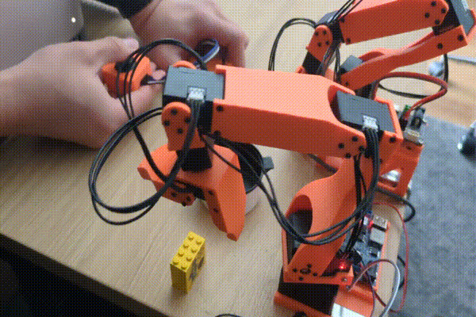

# koch_ros

ROS 2 packages for the Koch v1.1 robot arm, a low-cost 6-DOF manipulator with a gripper.

## Packages

- **koch_description**: URDF/Xacro robot description, meshes, and visualization configs
- **koch_controllers**: Custom ros2_control controllers for the robot

## Hardware backend (ROS 2 Kilted)

Install the maintained ROBOTIS plugin (validated with 1.5.1 and SDK 4.0.3):

```sh
sudo apt install ros-kilted-dynamixel-hardware-interface
```

All three control launches accept `hardware:=robotis|legacy|mock` (default
`robotis`), `follower_port:=/dev/ttyACM0`, and, when a leader is included,
`leader_port:=/dev/ttyACM1`. The same arguments work when rendering `koch.xacro`
or `koch_follower_standalone.xacro`. For a no-serial preview:

```sh
ros2 launch koch_description koch.launch.py hardware:=mock rviz:=false
ros2 launch koch_controllers leader_follower.launch.py hardware:=mock rviz:=false
ros2 launch koch_controllers claw_machine.launch.py hardware:=mock rviz:=false
```

`mock` uses `mock_components/GenericSystem`, not the old driver's `use_dummy`.
Its initial positions keep controller startup defined but do not model a motor.
To roll back, install/build the optional legacy `dynamixel_hardware` separately
and select `hardware:=legacy` with the appropriate ports. Its ros2_control block
and position/velocity command interfaces are retained. Never run two drivers
against the same bus. Display/Gazebo launches only render the default description;
they do not start this hardware plugin.

### Interfaces and units

ROBOTIS exposes follower **position commands only** and position/velocity/effort
states. Leader joints are **state-only**, with `Torque Enable=0` and no GPIO
command interfaces. No Koch controller needs velocity commands; the official
driver cannot switch operating mode at runtime. Six GPIOs in joint order map
IDs 1–2 to XL430-W250 (Present Load) and IDs 3–6 to XL330-M288 (Present Current).
Hardware Error Status is read for every servo. The firmware-specific model
files select the correct indirect address layouts (XL330 firmware 52 differs).

Position is radians, raw 2048 = 0, with 4096 counts/revolution. Velocity is rad/s;
a signed override uses the e-Manual's 0.229 rpm/count, matching legacy float math
within rounding (the upstream model multiplier is about 0.05% low). Effort is
signed raw × 2.69 for **both** models, preserving the legacy driver's convention.
This is **not Nm**, not comparable torque between models, and XL430 load is not
motor current. Explicit unit overrides also prevent unsigned negative XL430 loads.

### Startup, faults and torque safety

Mechanically support the follower before startup or shutdown. Initialization
requires torque off, explicitly sets `disable_torque_at_init=false`, and writes
Operating Mode 3 to EEPROM on every normal startup. It also configures indirect
addresses and follower position gains in RAM (see the xacros). It does not write limits, offsets or profiles. Activation reads
the measured pose, seeds Goal Position **before** enabling follower torque, and
leaves the leader torque-off. Claw control subsequently commands its configured
initial arm pose and opens the gripper; this is independent of driver seeding.

**Upstream 1.5.1 limitation:** torque checks and initialization happen per GPIO,
not as a whole-bus preflight. If an already torque-on servo is encountered,
activation is refused, with no torque or goal writes; preceding torque-off servos
may already have received Operating Mode 3 EEPROM and follower gain RAM writes.
Nothing is written to
the torque-on servo or later servos. Turn all servos off safely before startup.

`error_timeout_ms=500` is shared by activation and accumulated failed-read
periods. Unsupported Fast Bulk Read needs ten failed attempts before ordinary
Bulk Read fallback: the simulated bus takes about 355 ms. A 250 ms budget failed
before fallback, so 500 ms was chosen explicitly. Fast-supported startup, brief
read drops and one silent servo retain the last valid state (no zero-filled
positions). Sustained failure takes hardware out of active and deactivates its
command controllers, **without torque-off**: the follower keeps holding its last
goal. Restoring communication does not automatically reactivate it. This is not
an emergency stop, nor a hard wall-clock guarantee on a loaded machine.

Explicit deactivation/destruction attempts torque-off; a gravity-loaded arm can
drop. Do not rely on shutdown or a fault to release torque safely. The driver
ignores some command-write/torque-write failures and treats Hardware Error Status
primarily as diagnostics. Its cyclic write buffers also need upstream endurance
review for allocation/leak behavior. Simulated tests do not validate physical
bus timing, voltage, temperature, loads or independent safety supervision.

Each arm has its own `koch_follower/` or `koch_leader/` names:
`dxl_state` topic and `get_dxl_data`, `set_dxl_data`, `reboot_dxl`, `set_dxl_torque`
services. These callbacks can block the control loop; write/torque responses can
acknowledge queued requests, not successful register changes. Avoid runtime
follower torque re-enable: its service ordering differs from startup seeding and
can use a stale goal. Reboot acts on the configured bus, can re-enable follower
torque, and does not replay all initialization settings. Recovery must be
operator-controlled with the mechanism supported, not automatic service retries.

### Offline regression tests

`colcon test --packages-select koch_description koch_controllers` runs a pty
Protocol 2 simulator against the real installed plugin, Koch descriptions and
controller configurations in an isolated ROS environment. Every runtime port is
asserted to be a simulator-owned `/dev/pts/*`; mock-launch tests send no bus traffic.
The tests cover signed units, startup ordering/refusal, passive leader, transient
and sustained read faults, Fast Bulk fallback, leader/follower transforms, claw
motion/grasping and the three mock launches. The simulator implements CRC,
stuffing (not applied to Fast replies), both indirect layouts, EEPROM access
protection and idealized goal tracking. It is not a physical motor/USB emulator;
reboot only models torque/error reset, not a complete firmware restart.

Before using real arms: verify IDs/models/firmware and separate motor supply
requirements; support the mechanism and provide an independent power stop;
confirm all servos are torque-off; start with a restrained single servo; check
raw/ROS position, velocity, signed effort and error registers; verify leader
passivity and follower seed-before-enable; try tiny bounded motions; then verify
supported shutdown, fault/recovery behavior and sustained 80 Hz timing on both
buses. Simulator success alone is not a hardware safety approval.

## Controllers

### Follower trajectory controllers

`koch_description/launch/koch.launch.py` starts the joint state broadcaster and
two independent position trajectory controllers:

| Controller | Joints | `control_msgs/action/FollowJointTrajectory` action | `trajectory_msgs/msg/JointTrajectory` topic |
| --- | --- | --- | --- |
| `joint_trajectory_controller` | `follower_joint1`–`follower_joint5` | `/joint_trajectory_controller/follow_joint_trajectory` | `/joint_trajectory_controller/joint_trajectory` |
| `gripper_trajectory_controller` | `follower_joint_gripper` | `/gripper_trajectory_controller/follow_joint_trajectory` | `/gripper_trajectory_controller/joint_trajectory` |

Send five-joint arm trajectories separately from gripper trajectories. The arm
controller sets `interpolate_from_desired_state: true` so streamed or multi-message
references continue from the desired state rather than re-anchoring to measured
position, which left real servos with too little error to overcome friction.

Follower servo RAM gains are set at startup in `koch_hardware.xacro` (ROBOTIS)
and `koch_follower.xacro` (legacy):
P=1280 for joints 1–2 (XL430, D unchanged); P=2400/D=600 for joint 3 (XL330 elbow);
P=1200/D=600 for joints 4–5 and the gripper (XL330). Default P left a 20–30 count
dead band against gear/table friction; tuned unloaded moves settle within roughly
1–2 counts. Loaded joints still sag; the higher elbow P reduces gravity sag.
`Profile_Velocity` is intentionally unset (servo default 0). Leader tuning and
joint limits are unchanged. These controllers do not change the separate
leader-follower or claw-machine launches below.

### LeaderFollowerController
Teleoperation controller that mirrors a leader arm's joint positions to a follower arm.

```sh
ros2 launch koch_controllers leader_follower.launch.py
```

### ClawMachineController


Cartesian velocity controller for the follower arm with gripper control:
- Subscribes to `/cmd_vel` (geometry_msgs/TwistStamped) for end-effector velocity commands
- Subscribes to `/grasping` (std_msgs/Bool) to open/close the gripper
- Uses inverse kinematics with nullspace optimization to minimize end-effector rotation

```sh
ros2 launch koch_controllers claw_machine.launch.py
```

I made a teleop device using a ESP32-S3 board with a joystick and button to publish the `/cmd_vel` and `/grasping` commands. See the [picoros_playground](https://github.com/Maverobot/picoros_playground).
